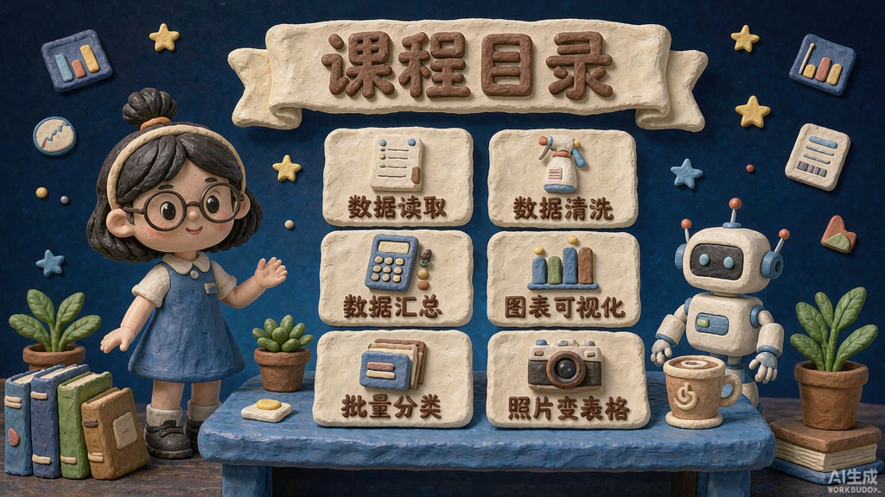

# meiyao-clay-ppt · 黏土风课件生成器

> 一套跑在 **WorkBuddy 原生环境**里的黏土风（polymer-clay diorama）PPT / 课件生成技能。
> 用内置 ImageGen 出图 + python-pptx 合成**可编辑**的 16:9 演示文稿。




---

## 核心原理：文字是「捏」出来的，不是「贴」上去的

这是整套效果成立与否的分水岭，也是**照着做却做不出同款的头号原因**。

黏土风好看，是因为画面里所有东西都在同一个物理世界里——**文字也一样**。
标题必须是一个个**厚实的立体黏土字块**，坐在黏土铭牌上，有厚度、有圆边、有指纹、有投影。

> ❌ **错误做法**：出图时留一块空铭牌 → 再用 PPT 脚本叠一行扁平黑体字。
> 扁平字没有厚度和阴影，和其他黏土件不在一个光照体系里，观感瞬间掉档。
>
> ✅ **正确做法**：把中文写进出图 prompt，明确要求
> `sculpted from thick 3D polymer-clay letters ... NOT flat printed text`。

上面那张目录页是同一套方法的第二个验证：**7 处中文全部正确**，
标题「课程目录」与六张卡片标签（数据读取 / 数据清洗 / 数据汇总 / 图表可视化 / 批量分类 / 照片变表格）
都是捏出来的黏土立体字。

| 文字类型 | 做法 |
|---|---|
| 标题 / 页眉 / 卡片标签 / 编号 | ✅ 烘进图，黏土立体字 |
| 成段正文 | ⚠️ 才走脚本叠加（`text_mode: "overlay"`） |
| 讲师备注 | 脚本写入 notes，不进画面 |

## 页页同款：标题只有一个入口（必读）

> 踩过的坑：第 9 页的标题是**一次性脚本 + 出图模型烘焙**出来的，没沉淀成函数 →
> 后面每做一页标题，都在旧函数上"重新发明一套参数"，**页与页必然不像**。
> 用户原话：「你为什么不能按出第 9 页的写法去出第 10 页的标题呢？为什么你一下子就像忘了规则一样？」

> 🚨 **第十一轮的硬发现**：第 9 页的「改法清单」其实是**出图模型直接画在底图
> `scene_p9v4_grain.png` 上的**（不是合成字）。四个字体 × 三档字号对它做墨迹掩膜 IoU
> **最高只有 0.64**（同字体同文字应 >0.9）。所以"两页标题怎么都对不上"是**结构性**的 ——
> 一页是模型画的、一页是代码捏的。**旧样本已归档为
> `assets/ref-title/_DEPRECATED_p9_title_model_baked.png`，禁止再拿它标定参数。**

现在标题被彻底工程化了，**四件东西保证"下次、别人也能出同款"**：

| # | 东西 | 作用 |
|---|---|---|
| 1 | `scripts/clay_text.py` 的 `render_title_clay()` | **唯一入口**。「厚实饱满的暖橙黄黏土字 + 极细米白边 + 字悬浮无底板 + 柔影 + 哑光细肌理」，对照**八六 p10 / p07** 实测标定 |
| 2 | `assets/fonts/NotoSansSC-VF.ttf` | 字体**随 skill 内置**（Noto Sans SC，SIL OFL 1.1，允许分发）。不依赖 Windows 系统字体 —— 换机器、换系统，字形都不变 |
| 3 | `assets/ref-title/gold_title.png` + `gold_metrics.json` + `scripts/verify_title.py` | **本机可复现**的金标准样本 + 7 项期望指标（含「底板横条比」），一条命令自检 PASS/FAIL |
| 4 | `scripts/verify_portable.py` | **可移植性验证**：把系统字体全砍掉、只留内置字体再渲一遍 → 证明"**别人拷走 skill 也能出同款**" |

### 用法

```bash
# 1) 换机器 / 改过脚本之后，先自检（会先打印字体解析结果）
python scripts/verify_title.py
python scripts/verify_portable.py     # 模拟"别人那台没有中文字体"的机器

# 2) 出标题（只允许调"字有多高"和"字距"）
python scripts/make_title.py "从改到造" 80
python scripts/make_title.py "从改到造" 80 -o out/title.png            # 指定输出
python scripts/make_title.py "从改到造" 80 --on 底图.png 26 25 出图.png   # 直接贴到底图
```

- `cap_height` = **成品 ink 高**（就是"你要的字有多高"）。默认 80。
- `letter_gap` 默认 0.075 —— **别往小调**，小于 `2×(bold+pad)` 相邻字的边会并成一条横条
  （就是用户两次点名的"橙色长条底板托着文字"）。
- 其余参数（`weight / stretch_x / bold / pad / 面色 / 边色 / 影 / grain / bevel`）
  都是定稿标定值，**一律不要传**。

### 贴标题三条硬规矩（第十一轮新增）

1. **标题最后贴** —— 放在全页暗角/颗粒之后。贴在前面会被暗角压暗 ~9%（实测 189 vs 207）。
2. 按**墨迹**对齐，**墨迹不许压在背景的木质道具/实景上** —— 否则又被读成"贴在木板上/有底板"。
3. 字号与位置**全册统一**（同一 `cap_height`、同一墨迹左上角），两页才真的"同款"。

### 交付前判据（机检，不靠肉眼）

| 指标 | 金标准 | 容差 |
|---|---|---|
| ink 宽 × 高 | 313 × 79 | ±5% / ±3px |
| 字面宽高比 | 3.962 | ±0.20 |
| **边宽 / 字高** | **0.0180** | 偏差 ≤0.010（**>0.06 = 厚奶油垫 = "纯文字框"**）|
| 字面中位色 | (206,143,49) | ±14 |
| 边色中位 | (226,218,204) | ±26 |
| **底板横条比** | **0.054** | **≤0.45**（超了就是"长条底板"）|
| 字面颗粒 | 1.85 | ≥ 金标准 50%（太低=纯平涂、像贴纸）|

`verify_title.py` 全 OK 才出页；出现 FAIL 先看它打印的字体解析行。

## 它能做什么

给一个主题（比如"Excel 数据处理实战"），自动产出一整套**手工黏土定格动画质感**的幻灯片：

- Q 版黏土讲师形象（发型 / 发饰 / 眼镜 / 服装可定制）
- 微缩黏土场景 + 奶油色黏土铭牌 + **捏出来的中文黏土立体字**
- 输出 `.pptx`（含讲师备注；正文可选叠加为可编辑文本）

## 为什么是"原生"

| | 外部 Codex 版 skill | 本 skill |
|---|---|---|
| 出图 | Codex Image2 | **WorkBuddy 内置 ImageGen** |
| 合成 | 外部脚本 | **python-pptx**（本仓库自带） |
| 额外 hook | 可能混入审美检查流程 | **无，纯本流程** |
| 成本控制 | — | **三步确认法，逐张确认不浪费额度** |

## 核心：三步确认法

**绝不一上来批量出图**，按下面顺序逐步确认：

1. **角色锚点** — 出 1 张 `1024×1024`，确认人物特征
2. **封面** — 出 1 张 `1024×576`，主标题以**黏土立体字**烘进图，确认整页效果
3. **批量内页** — 确认后才生成目录 + 内容页 + 总结页（**每页标题同样烘进图**）
4. **合成** — `scripts/build_pptx.py` 铺满页面 + 写入讲师备注

## 安装

```bash
git clone https://github.com/ywu661266-vicky/meiyao-clay-ppt.git ~/.workbuddy/skills/meiyao-clay-ppt
```

或把本目录整个复制到 `~/.workbuddy/skills/` 下即可。

## 触发方式

在 WorkBuddy 里说：

- "做一套黏土风 PPT"
- "把这个主题做成黏土风"
- "要 Q 版讲师形象的幻灯片"
- "clay style ppt"

## 目录结构

```
meiyao-clay-ppt/
├── SKILL.md                        # 主流程（第一性原理 / 触发词 / 三步确认法）
├── README.md                       # 本文件
├── LICENSE                         # MIT
├── references/
│   ├── workflow.md                 # 三步确认法细节 + 翻车对策
│   ├── prompts.md                  # 实测通过的提示词模板（含黏土立体字标准段）
│   ├── style-system.md             # 配色 / 材质 / 构图 / 文字规范
│   └── imagegen-params.md          # ImageGen 参数与踩坑
├── scripts/
│   └── build_pptx.py               # 页面图 → 16:9 PPTX（默认不叠扁平字）
└── assets/examples/                # 成功样例（角色锚点 / 封面 / 目录页）
```

## 关键发现（踩坑记录）

- **文字必须烘进图，且必须写成黏土立体字。** 用脚本叠扁平字 = 一眼假。prompt 里必须带
  `sculpted from thick 3D polymer-clay letters ... not flat printed text`；
  同时**不要**再写旧版的 `No written words`。
- WorkBuddy ImageGen **没有 `aspect_ratio` 参数**，比例只能用 `size`（16:9 → `1024x576`，角色 → `1024x1024`）。
- 混元 **能渲染可读中文**：中文字符串用单引号写进 prompt，并追加
  `Make every Chinese character clearly readable and correctly formed, no garbled characters.`
  - 实测：13 字中英混排标题（`AI + Excel 数据处理实战`）✅
  - 实测：一页 7 处中文（1 个标题 + 6 个卡片标签）✅
  - 保险做法：标题 ≤ 8 字、卡片标签 ≤ 5 字。
- 内置出图右下角固定 `AI生成 WORKBUDDY` 水印，版式需避开右下角。
- **不要用同一张图既烘字又叠字**：`slides.json` 里烘过字的页不要再写 `title`，
  否则会压出两层标题（脚本默认 `text_mode: "baked"` 已自动跳过叠字并告警）。

## License

MIT
